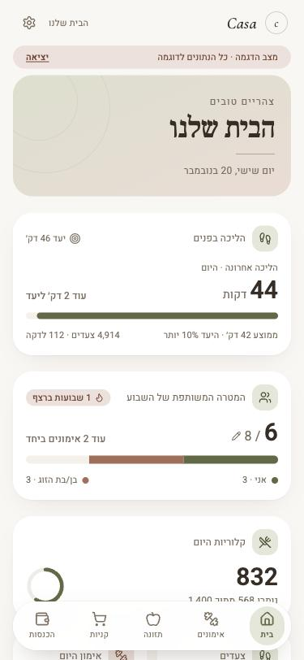

# Casa

[](https://github.com/tomero830-cmyk/casa/actions/workflows/ci.yml)

A mobile-first household app for two: nutrition and calorie balance, weight trends with a goal forecast, workouts, a smart shopping list, and private income tracking. Hebrew UI, right-to-left, installable as a PWA.

> Built and used daily by a couple. Each person gets their own private data; the shopping list and workouts are shared.

**[Try the live demo →](https://casa-seven-xi.vercel.app/demo)** (sample data, no sign-up; runs on an in-memory client)

<p align="center"></p>

## Highlights

- **Weight-goal forecast** – least-squares trend over the last ~6 weeks of weigh-ins, projected to the user's goal with a confidence level (`src/lib/weightForecast.js`, pure and testable).
- **Strength log** – per-set logging with last-session hints, automatic PR detection (Epley 1RM), progress charts and reusable workout templates (`src/lib/gym.js`).
- **Shared weekly goal** – workout days from gym sets, watch workouts and completed plans, de-duplicated per person-day, with a streak (`src/lib/weeklyGoal.js`).
- **Watch workouts** – indoor walks (time goal = recent average +10%) and outdoor runs (weekly km, pace) synced from Apple Health.
- **iPhone widget** – a Scriptable script backed by a read-only, token-authenticated serverless function.
- **Weekly push summary** – Web Push (VAPID) from a Deno function, scheduled by GitHub Actions every Sunday.
- **Restock suggestions** – learns each item's typical repurchase interval from shopping history and suggests what is probably running out (`src/components/shopping/RestockSuggestions.jsx`).
- **AI food logging** – photo or free-text meal → structured nutrition items via an LLM with a JSON schema.
- **Apple Health sync** – an iOS Shortcut posts daily steps and burned calories to a Deno server function (`base44/functions/logSteps`), authenticated with a shared secret and attributed per user.
- **Optimistic UI** – the shopping list updates instantly and rolls back on failure (TanStack Query `onMutate` / rollback).
- **Design system** – CSS-variable theme with automatic dark mode, soft card surfaces, floating navigation, direction-aware page transitions (framer-motion), thin line icons, Hebrew serif/sans pairing.
- **Privacy by default** – per-user data is filtered on the server (`created_by`), no personal values in code; household-specific settings come from environment variables.

## Stack

React 18 · Vite · React Router 6 · TanStack Query · Tailwind CSS + shadcn/ui · Recharts · framer-motion · date-fns  
Backend: [Base44](https://base44.com) (entities, auth, LLM and file integrations, Deno functions)  
Hosting: Vercel (SPA rewrites + `/api` proxy to Base44) · CI: GitHub Actions (lint, Vitest, build) · Tests: Vitest

## Architecture

```
iPhone (PWA) ──► Vercel static site ──► /api/* rewrite ──► Base44 API
                                                              ├─ Entities (FoodEntry, WeightEntry, Workout, ShoppingItem, IncomeEntry…)
                                                              ├─ Auth (email/password, Google, MFA)
                                                              └─ LLM + file upload integrations
iOS Shortcut (nightly) ──► Base44 function logSteps ──► FoodEntry (__steps__, __calories_burned__)
```

```
src/
  pages/               routed screens (Dashboard, Nutrition, Workouts, Shopping, Income…)
  components/          feature components, grouped by module; shadcn primitives in components/ui
  lib/                 auth context, date helpers, forecast math, notifications
base44/
  entities/*.jsonc     data schemas
  functions/logSteps   Deno server function for Apple Health sync
```

## Running locally

```bash
npm install
cp .env.example .env.local   # set VITE_BASE44_APP_ID and VITE_BASE44_APP_BASE_URL
npm run dev
```

`npm run build` · `npm run lint` · `npm test` (Vitest unit tests for the forecasting, gym, walking and restock logic)

CI (GitHub Actions) runs lint, tests and a production build on every push.

## Deploying

Import the repo in Vercel, set the variables from `.env.example`, and deploy. `vercel.json` proxies `/api/*` to Base44 and serves `index.html` for client-side routes. Netlify works the same way via `public/_redirects`.
